<div align="center">


# Talkie

**Chat, play and work together.**

A company chat app with direct messages, groups and server channels, plus a game layer:<br/>
earn money and shards, open boxes, buy avatar effects and go AFK.


📘 **[Read the full manual (PDF, with screenshots)](docs/Talkie-Manual.pdf)**

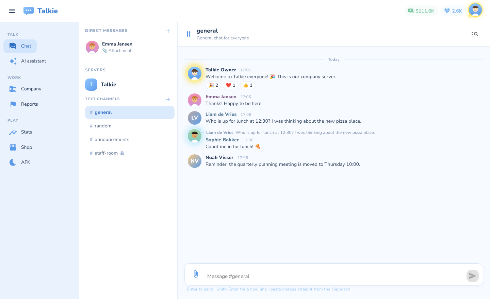

</div>

---

## Contents

- [Quick start](#quick-start)
- [Built-in accounts](#built-in-accounts)
- [Features](#features)
- [Screenshots](#screenshots)
- [Architecture](#architecture)
- [Project structure](#project-structure)
- [Configuration](#configuration)
- [API overview](#api-overview)
- [Development](#development)

---

## Quick start

**Requirements:** [.NET 10 SDK](https://dotnet.microsoft.com/download) and Docker (or Podman).

```bash
git clone https://github.com/tomvanoost/talkie.git
```

```bash
cd talkie
```

```bash
dotnet run --project src/Talkie.AppHost
```

The Aspire AppHost starts **SQL Server 2025**, **MailPit**, the **migration service** (creates the schema and the built-in accounts, then exits), the **API** and the **web** front end. Open the dashboard link printed in the console and click the URL of the `web` resource.

## Built-in accounts

| E-mail | Password | What it is |
| --- | --- | --- |
| `owner@talkie.com` | `fwkh837h@m1` | Owner of the built-in **Talkie** company |
| `admin@talkie.com` | `TalkieAdmin1!` (Aspire parameter `admin-password`) | App administrator: the **pencil button** next to the avatar configures the app; only this account can remove reports |

> The company name **Talkie** is reserved — nobody can create another company with that name.

## Features

### 🔐 Login & companies
- **Login** or **Create Company** on the start screen.
- Creating a company asks for the company **name**, the **owner e-mail**, the **owner password**, the owner's **username** and **display name**, and optional **roles** — click **+** to add roles with a name and a color (editable later).
- Every company automatically gets a **server named after the company** with `#general` and `#random`.

### 💬 Chat
- **Direct Messages**: click **+**, type someone's e-mail and start chatting.
- **Groups**: the same **+** menu creates a group with multiple people. The **group owner can delete any message**.
- **Attach files**, **paste images** from the clipboard (images are shown inline), **reply** to messages and **react with emoji**.
- **Servers & text channels**: owners create channels with a **name, description, roles** (who can see it — with a **+** to create new colored roles) and **permissions** per role: **Send messages**, **Delete messages**, **React with emoji**. Default: everyone can send messages and react with emoji.
- **Real-time** updates via SignalR.
- **Semantic search** over all your messages, powered by SQL Server 2025's native `vector` type.

### 🤖 AI assistant
A simple assistant that knows how Talkie works, can show your stats and search your chats. Works offline out of the box; plug in any OpenAI-compatible model (OpenAI, Azure OpenAI, Ollama, …) with three settings.

### 🏢 Company
View members, **add members** (name, surname, e-mail — a temporary password is e-mailed), **edit members** and **give them roles**, and **delete members** — which also deletes their account and e-mail address.

### 🚩 Reports
Everyone can report a user with a reason. **admin@talkie.com** sees all reports and is the only one who can remove them.

### 📊 Stats
Money, Shards, Playtime, chat messages sent and boxes opened — plus a company leaderboard.

### 🛍️ Shop
| Item | Price | Rewards / effect |
| --- | --- | --- |
| Common Box | $200 | $100, $200, $500 or $1K |
| Rare Box | $500 | $200, $500, $1K, $5K or $10K |
| Shard Box | $1K | 100, 200, 500, 1K or 5K shards |
| Avatar effects | $1.5K – $15K | Energy Lightning ⚡, Sparkles, Floating Hearts, Frost Aura, Blazing Fire, Rainbow Halo, Galaxy Orbit |
| Shard boosters | $10K / $50K | x2 / x4 shards while AFK |

Buy shards with money and money with shards. After buying a box, **tap it as fast as you can** to open it.

### 🌙 AFK
Click **Go AFK** → *"Are you sure you want to go AFK?"* → **Yes** / **No**. Earn **1 shard every minute** (times your booster), calculated on the server so it keeps counting when the browser is closed.

### 🔢 Number formatting
`1000 = 1K`, `1000000 = 1M`, then `1B`, `1T` and `1Q` — everywhere in the app.

### ✏️ App configuration (admin@talkie.com)
The pencil button configures the app name, an announcement banner, whether new companies may be created, starting balances, AFK rate and limit, exchange rates and box prices; lists and deletes companies; and grants money or shards.

## Screenshots

| | |
| --- | --- |
| 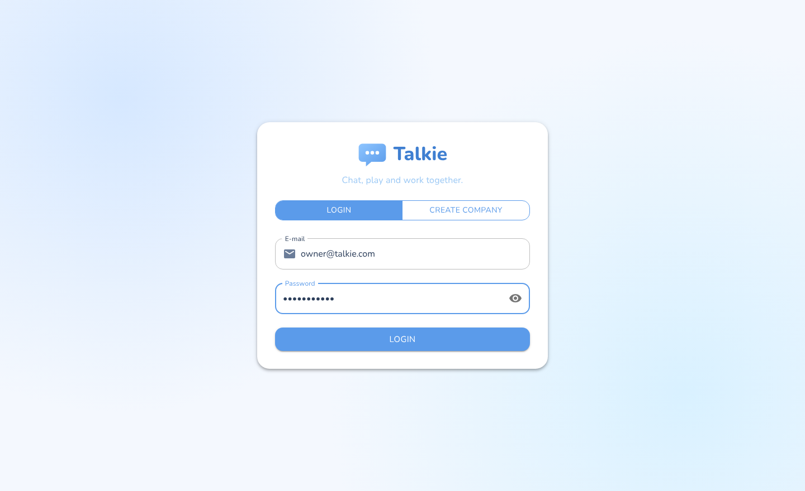 Login | 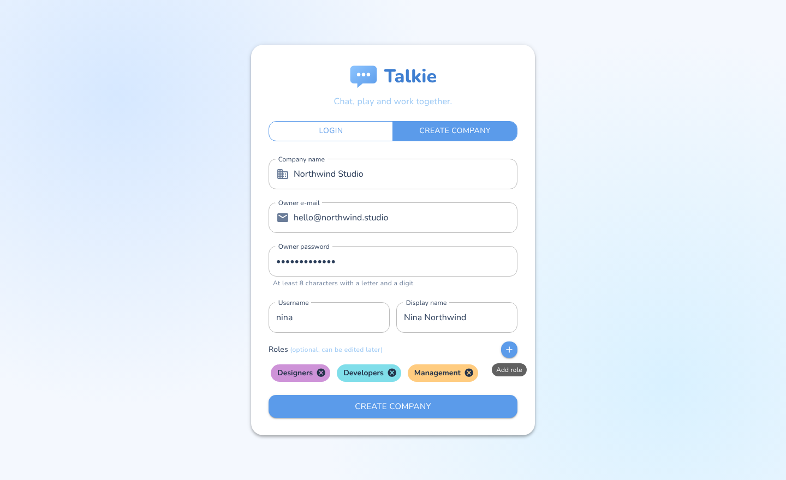 Create company with roles |
| 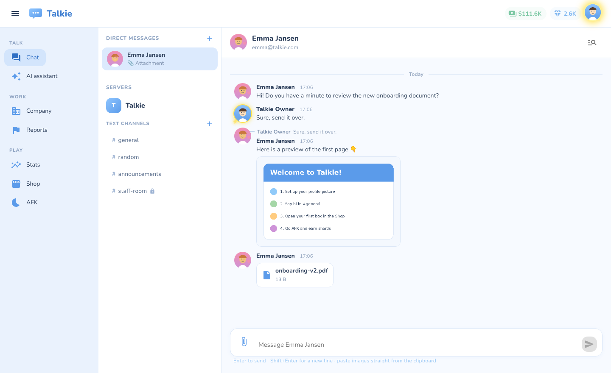 Direct message with attachments | 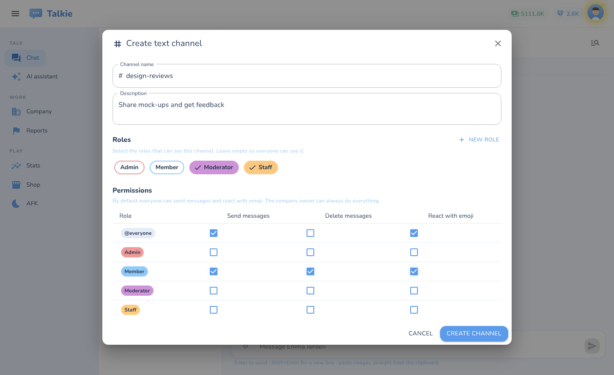 Channel roles & permissions |
| 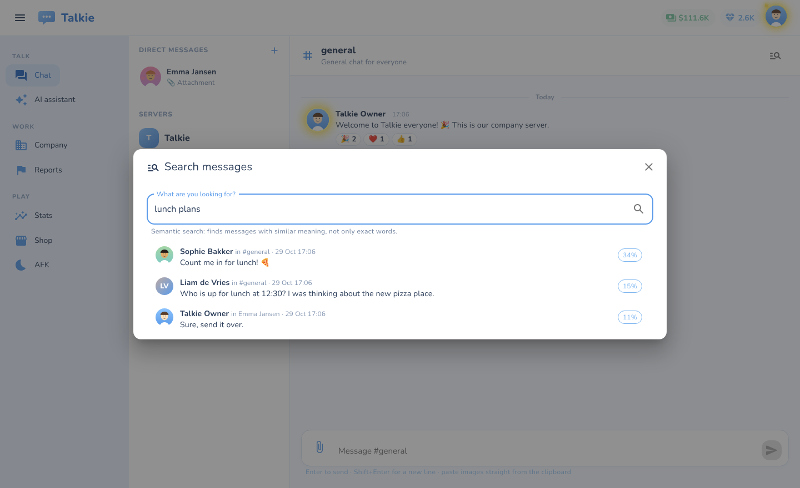 Semantic search | 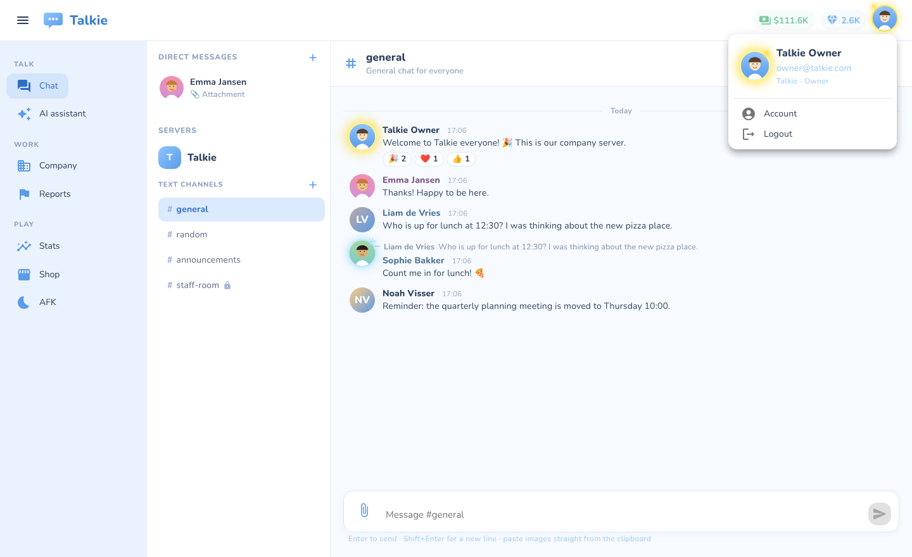 Avatar dropdown |
| 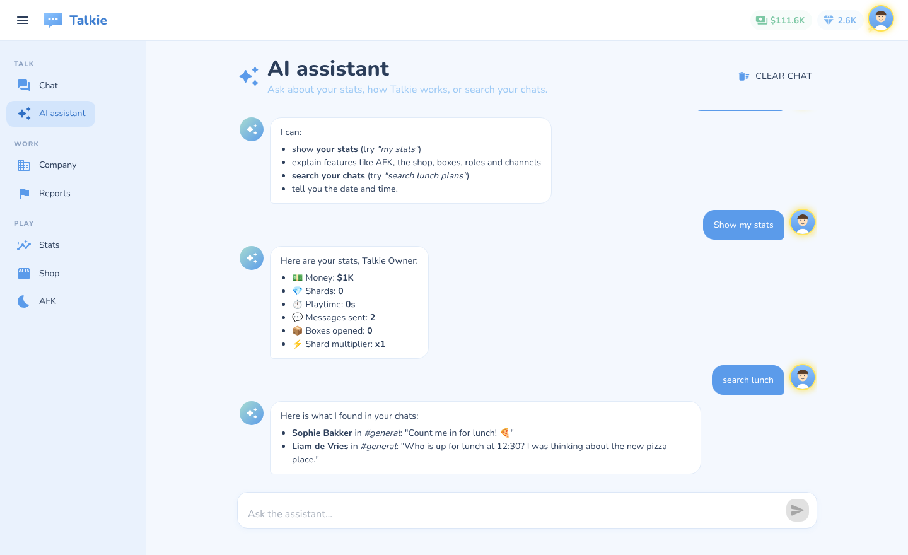 AI assistant | 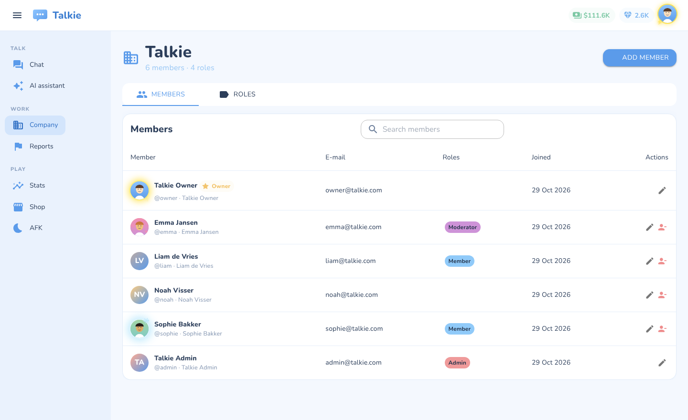 Company members |
| 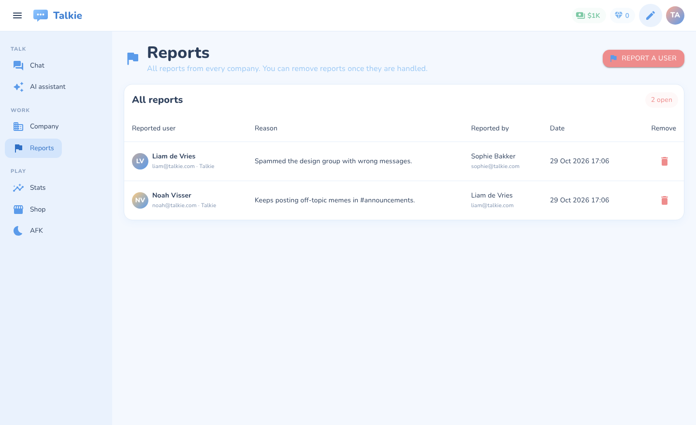 Reports (admin) | 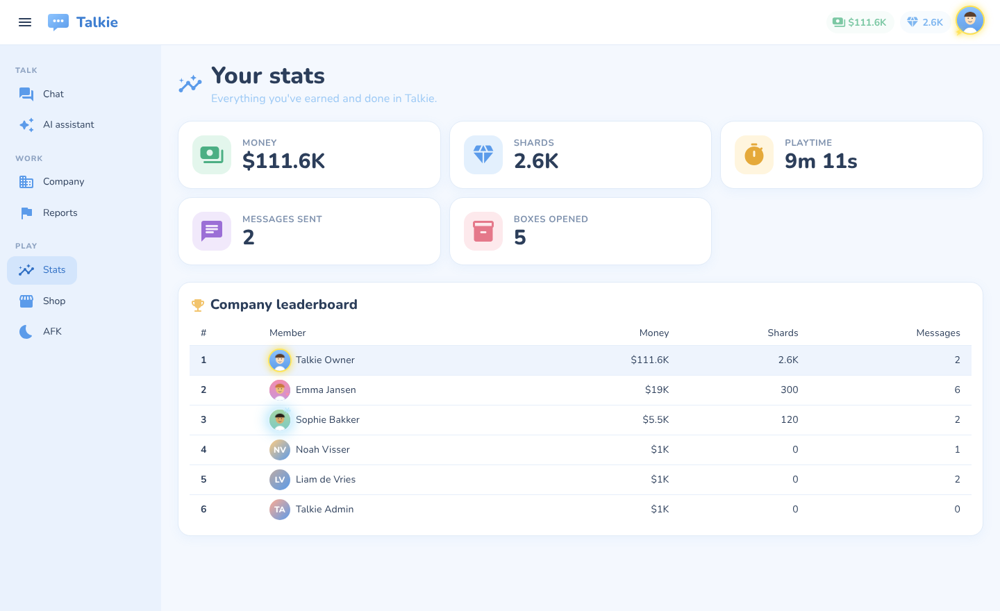 Stats |
| 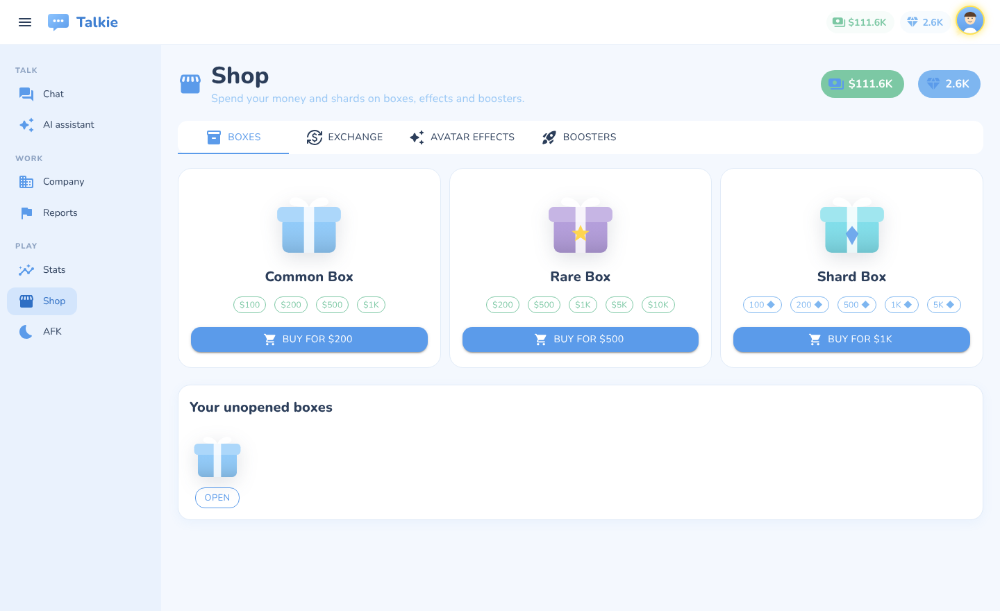 Shop boxes | 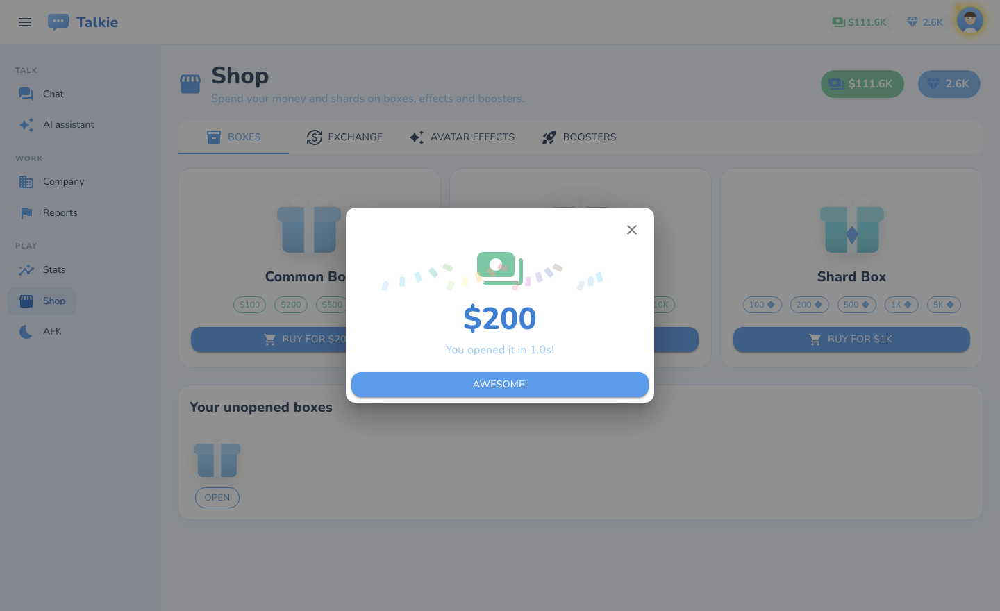 Box reward |
| 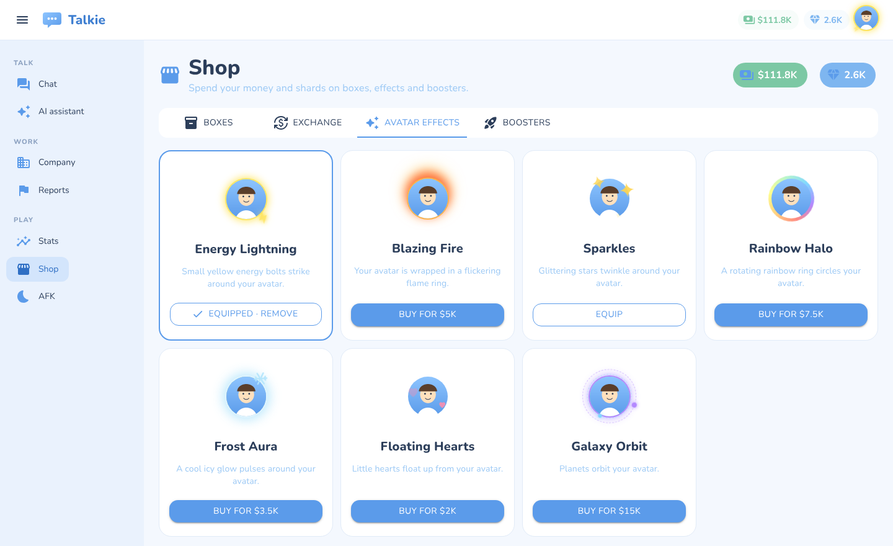 Avatar effects | 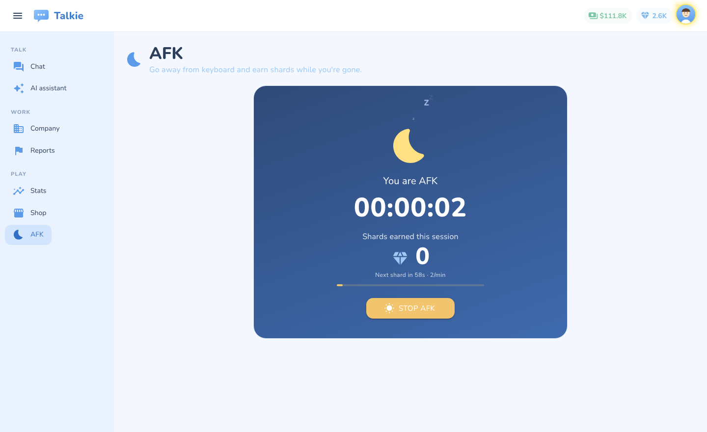 AFK |
| 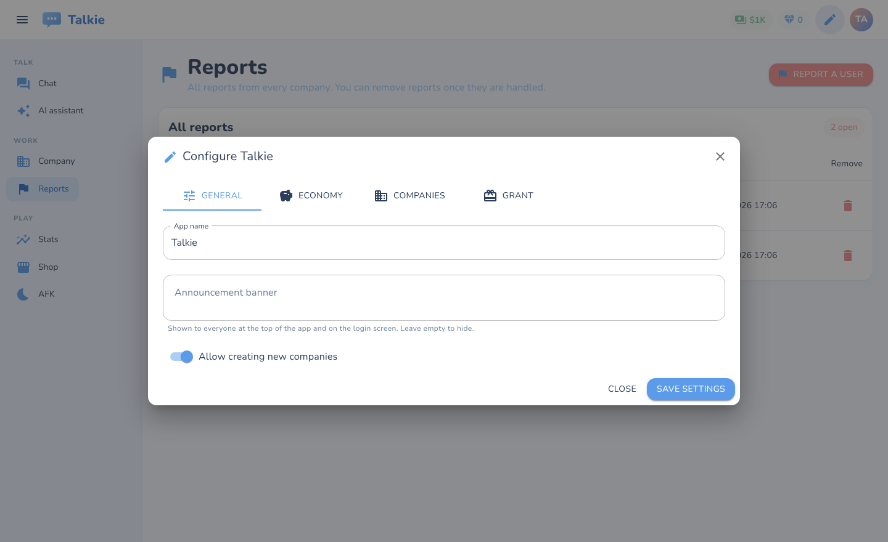 Pencil button: configure the app | 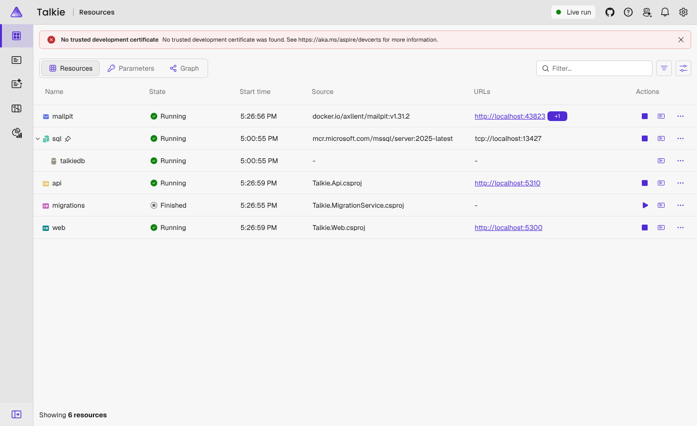 Aspire dashboard |

All 40 screenshots are in [`docs/screenshots`](docs/screenshots) and explained in the [manual](docs/Talkie-Manual.pdf).

## Architecture

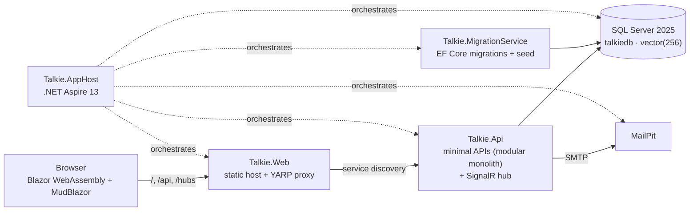

| Layer | Technology |
| --- | --- |
| Frontend | Blazor WebAssembly (.NET 10), MudBlazor, pastel blue theme, English UI, SignalR client |
| Backend | ASP.NET Core minimal APIs as a **modular monolith** — each module (`Auth`, `Company`, `Chat`, `Servers`, `Ai`, `Reports`, `Stats`, `Shop`, `Afk`, `Admin`) registers its own services and endpoints via `IModule` |
| Data | EF Core 10 on **SQL Server 2025** (compatibility level 170). Message embeddings live in a native `vector(256)` column and are ranked with `VECTOR_DISTANCE('cosine', …)` |
| AI | `Microsoft.Extensions.AI` — an offline hashing `IEmbeddingGenerator`, a built-in rule-based assistant, or any OpenAI-compatible `IChatClient` |
| Hosting | **.NET Aspire 13**: SQL Server, MailPit, migrations, API and web |

**Security highlights:** ASP.NET Core Identity password hashing, signed JWTs (key generated by Aspire), every request re-checks that the account still exists (deleted members are logged out at once), balance changes are single conditional `UPDATE` statements (no negative balances, no double spending), box rewards are rolled server-side with a CSPRNG, role-based channel visibility and permissions are enforced by the API.

## Project structure

```
Talkie.slnx
├── src
│   ├── Talkie.AppHost            .NET Aspire orchestration
│   ├── Talkie.ServiceDefaults    OpenTelemetry, health checks, service discovery
│   ├── Talkie.Shared             DTOs, shop catalog, number formatter (shared by API and client)
│   ├── Talkie.Data               EF Core entities, DbContext, migrations, seeder
│   ├── Talkie.MigrationService   Applies migrations + seeds, then exits
│   ├── Talkie.Api                Minimal API modules + SignalR hub
│   ├── Talkie.Web                Hosts the WebAssembly app, proxies /api and /hubs
│   └── Talkie.Web.Client         Blazor WebAssembly + MudBlazor UI
├── tests/Talkie.Tests            xUnit v3 unit tests
└── docs
    ├── Talkie-Manual.pdf         The manual
    ├── screenshots/              Screenshots used in the README and manual
    └── tools/                    Demo seeding, screenshot and manual generators
```

## Configuration

| Setting | Where | Purpose |
| --- | --- | --- |
| `auth-signing-key` | Aspire parameter (generated & persisted) | JWT signing key → `Auth__SigningKey` on the API |
| `admin-password` | Aspire parameter | Initial password for `admin@talkie.com` |
| `Seed:OwnerPassword` | Migration service | Initial password for `owner@talkie.com` (default `fwkh837h@m1`) |
| `AI:Endpoint`, `AI:Model`, `AI:ApiKey` | API | Optional OpenAI-compatible model for the assistant |
| `ConnectionStrings:talkiedb` / `mailpit` | API, migrations | Injected by Aspire |

Running the API outside Aspire requires `ConnectionStrings__talkiedb` and `Auth__SigningKey` (≥ 32 bytes).

## API overview

| Module | Endpoints |
| --- | --- |
| Auth | `POST /api/auth/login`, `POST /api/auth/companies`, `GET /api/auth/settings` |
| Account | `GET /api/account/me`, `PUT /api/account/profile`, `PUT /api/account/password`, `POST/DELETE /api/account/avatar`, `POST /api/account/heartbeat` |
| Company | `GET /api/company`, `GET/POST /api/company/members`, `PUT/DELETE /api/company/members/{id}`, `POST/PUT/DELETE /api/company/roles` |
| Chat | `GET /api/conversations`, `POST /api/conversations/direct`, `POST /api/conversations/group`, `GET/POST /api/conversations/{id}/messages`, `POST /api/uploads`, `GET /api/attachments/{id}`, `DELETE /api/messages/{id}`, `POST /api/messages/{id}/reactions`, `GET /api/search` |
| Servers | `GET /api/servers`, `POST /api/servers/{id}/channels`, `PUT/DELETE /api/channels/{id}`, `GET/POST /api/channels/{id}/messages` |
| AI | `GET/DELETE /api/ai/history`, `POST /api/ai/ask` |
| Reports | `GET/POST /api/reports`, `DELETE /api/reports/{id}` (admin) |
| Stats | `GET /api/stats`, `GET /api/stats/leaderboard` |
| Shop | `GET /api/shop`, `POST /api/shop/shards/buy`, `POST /api/shop/shards/sell`, `POST /api/shop/boxes/{key}/buy`, `POST /api/shop/boxes/{id}/open`, `POST /api/shop/effects/{key}/buy`, `PUT /api/shop/effects/active`, `POST /api/shop/boosters/{key}/buy` |
| AFK | `GET /api/afk`, `POST /api/afk/start`, `POST /api/afk/stop` |
| Admin | `GET/PUT /api/admin/settings`, `GET /api/admin/companies`, `DELETE /api/admin/companies/{id}`, `POST /api/admin/grant` |

In development the OpenAPI document is served at `/openapi/v1.json` on the API.

## Development

Run the unit tests:

```bash
dotnet test --project tests/Talkie.Tests
```

Add an EF Core migration:

```bash
dotnet tool restore
```

```bash
dotnet ef migrations add <Name> --project src/Talkie.Data -o Migrations
```

Fill a running instance with demo data and run an end-to-end API check (pass the `web` URL):

```bash
python3 docs/tools/seed_demo.py http://localhost:<web-port>
```

Regenerate the screenshots and the manual:

```bash
node docs/tools/screenshots.cjs http://localhost:<web-port> docs/screenshots
```

```bash
python3 docs/tools/build_manual.py
```
